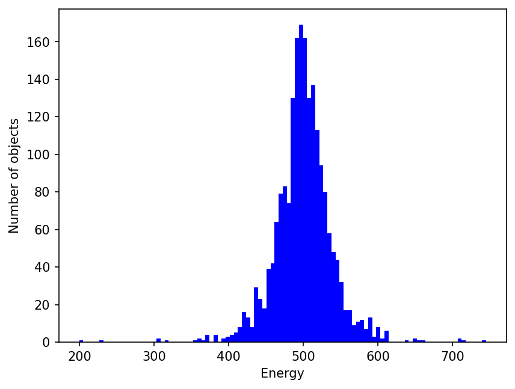
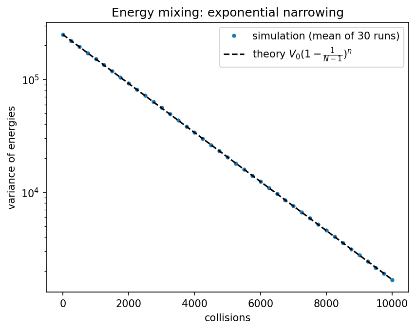

# Energy-Mixing Simulation

2000 objects — half cold (0.1), half hot (1000) — repeatedly pair up at random and share their energy equally.

## Physics
**Governing rule.** In each collision two random objects $i,j$ both take the average of their energies, $e_i,e_j\to\tfrac12(e_i+e_j)$. This conserves total energy exactly and removes $\tfrac12(e_i-e_j)^2$ from the sum of squares. Averaging over random pairs, the variance of $N$ objects decays as

$$\mathrm{Var}(n)=\mathrm{Var}(0)\Big(1-\frac1{N-1}\Big)^{n}\approx \mathrm{Var}(0)\,e^{-n/(N-1)}$$

**Why this method.** A direct simulation of random collisions is the most transparent model of a relaxing system, and the closed-form decay above gives something to check it against.

**What the result means.** The mean stays at 500.05 (energy conservation) while the spread shrinks from about 500 to about 40 after 10 000 collisions: roughly 5 e-foldings, since one e-fold takes about $N$ collisions. With equal sharing every object tends to the mean; if the energy were split at random instead, the long-time distribution would be exponential (Boltzmann-like) rather than a single spike.

## Run
```bash
python energy_mixing.py
python energy_mixing.py --collisions 50000 --seed 1
```
Run any script with `--help` to list its options. Figures are written to `output/`.

## Result
Mean stays **500.05**; the spread shrinks from ≈500 to ≈40.



## Accuracy
```bash
python energy_mixing_convergence.py
```
Averaged over 30 runs, the simulated variance follows the predicted exponential decay (final variance 1674 simulated vs 1678 predicted).



## Tested by
`test_energy_mixing_conserves_energy_and_narrows_distribution, test_energy_mixing_runs_are_independent, test_energy_variance_decays_as_predicted` in [`tests/test_projects.py`](../../tests/test_projects.py).
