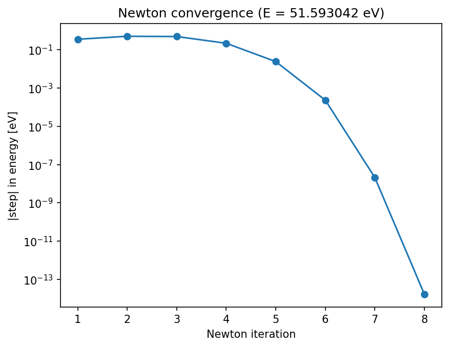

# Finite-Well Energy (Newton)

Finds an allowed energy by solving the transcendental condition k + k′·tan(kw) = 0.

A plain-language summary is in [ABOUT.txt](ABOUT.txt).

## Physics
**Governing equation.** Matching the wave function and its derivative at the boundary of a piecewise-constant potential gives a condition that cannot be solved for $E$ in closed form:

$$f(E)=k+k'\tan(kw)=0,\qquad k=\frac{\sqrt{2mc^2E}}{\hbar c},\quad k'=\frac{\sqrt{2mc^2(E-V_0)}}{\hbar c}$$

Roots are the allowed energies.

**Why this method.** $f$ is smooth near a root, so Newton's method, $E\leftarrow E-f/f'$, converges quadratically (the number of correct digits roughly doubles each step). It needs a starting guess close enough to the root, with $E>V_0$ so that both wavenumbers are real; different guesses find different roots.

**What the result means.** For $V_0=10$ eV and $w=10^6$ the iteration settles on $E=51.5930$ eV from a starting guess of 50 eV, with $f$ vanishing there to rounding error.

## Run
From the repository root, `cd projects/finite-well-newton` first, then:
```bash
python well_energy.py
python well_energy.py --v0 10 --width 1e6 --guess 70
```
Run any script with `--help` to list its options.

## Result
E = **51.5930 eV** for V₀ = 10, w = 10⁶.

## Accuracy
```bash
python well_convergence.py
```
The Newton steps shrink as $2.4\times10^{-2}\to2.3\times10^{-4}\to2.1\times10^{-8}\to1.7\times10^{-14}$: each is roughly the square of the one before, the signature of quadratic convergence.



## Tested by
`test_well_energy_is_a_root_of_the_equation, test_newton_converges_quadratically` in [`tests/test_projects.py`](../../tests/test_projects.py).
