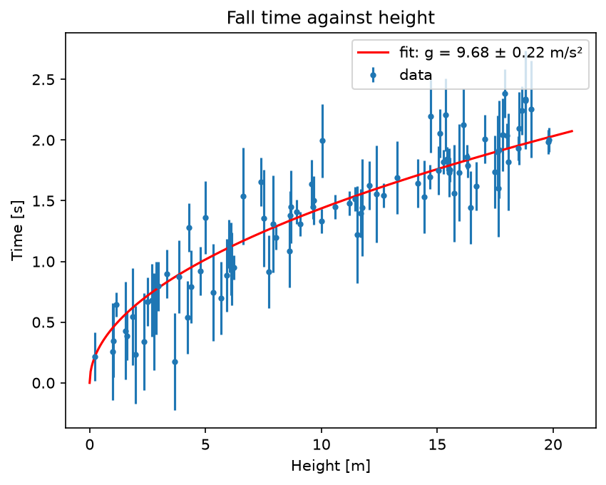

# Free-Fall g Estimator

Estimates the gravitational acceleration from drop experiments with per-point timing uncertainties.

A plain-language summary is in [ABOUT.txt](ABOUT.txt).

## Physics
**Governing equation.** Constant acceleration from rest gives $s=\tfrac12 g t^2$, so the fall time is

$$t(s)=\sqrt{\frac{2s}{g}}$$

**Why this method.** The model is non-linear in $g$ and the points have different uncertainties $\sigma_i$, so we minimise the weighted $\chi^2=\sum_i\big[(t_i-t(s_i;g))/\sigma_i\big]^2$ with `curve_fit`. With `absolute_sigma=True` the covariance matrix gives a real 1σ uncertainty on $g$ rather than a rescaled one.

**What the result means.** The fit gives $g=9.68\pm0.22$ m/s², which is 0.6σ from the standard 9.81 m/s². The reduced $\chi^2$ is 0.73 (90 degrees of freedom), so the model describes the data well and the quoted timing errors are not underestimated.

## Run
From the repository root, `cd projects/free-fall-g-estimator` first, then run it. For example:
```bash
python g_estimator.py
python g_estimator.py drops.csv      # columns: height[m], time[s], time_uncertainty[s]
```
Reads its input from `data/`. Run any script with `--help` to list its options. Figures are written to `output/`.

## Result
**g = 9.68 ± 0.22 m/s²** (consistent with 9.81).



## Tested by
`test_g_estimator_recovers_known_g (synthetic data with known g)` in [`tests/test_projects.py`](../../tests/test_projects.py).
