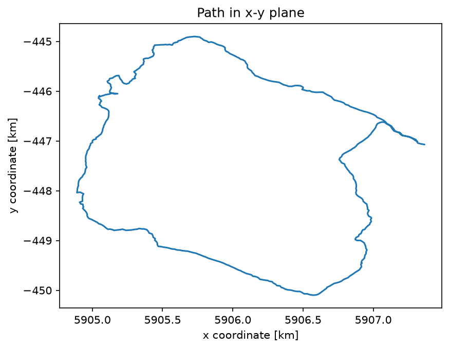
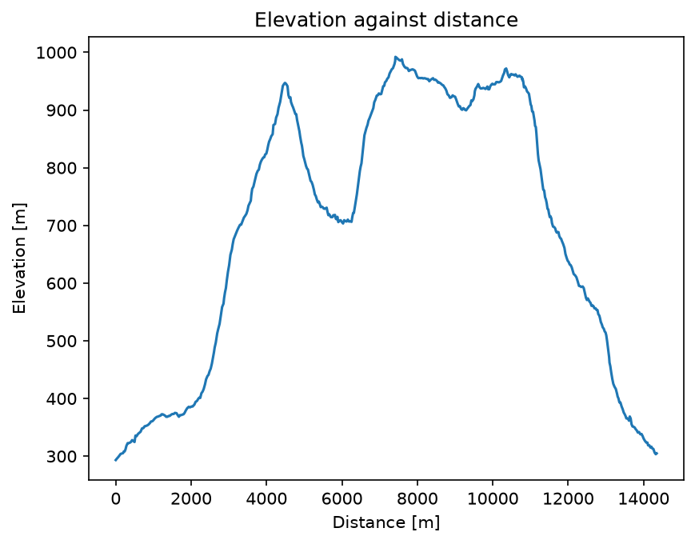

# GPS Route Analyzer

Turns raw GPS samples (x, y, elevation) into a route map, an elevation profile and a total distance.

A plain-language summary is in [ABOUT.txt](ABOUT.txt).

## Physics
**Governing relation.** The horizontal path length is the sum of straight chords between consecutive fixes:

$$L=\sum_{i}\sqrt{(x_{i+1}-x_i)^2+(y_{i+1}-y_i)^2}$$

**Why this method.** A GPS track is a finite set of position samples, so summing chords is the natural estimator of the path length. It slightly under-counts wiggles between fixes and ignores height: including the elevation change gives 14.67 km, about 2 % more than the 14.35 km horizontal distance.

**What the result means.** The route is a roughly 14.3 km near-loop (start and end are about 80 m apart) that climbs from 293 m to 992 m, with about 1130 m of total ascent.

## Run
From the repository root, `cd projects/gps-route-analyzer` first, then run it. For example:
```bash
python route_analysis.py                 # bundled sample
python route_analysis.py my_track.csv       # your own CSV: x[m], y[m], elevation[m], ...
```
Reads its input from `data/`. Run any script with `--help` to list its options. Figures are written to `output/`.

## Result
**14 348.7 m** over 528 fixes.





## Tested by
`test_route_distance_matches_reference` in [`tests/test_projects.py`](../../tests/test_projects.py).
