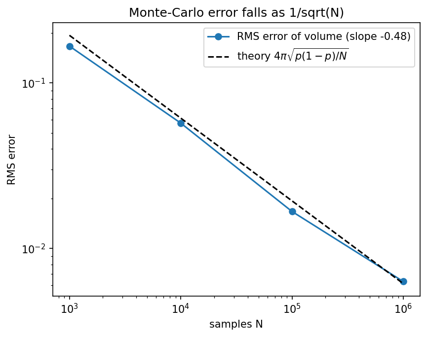

# Monte-Carlo Solid

Volume and mass of the solid x² + y² < cos²z with a spatially varying density.

## Physics
**Governing integrals.** The solid is the set where $x^2+y^2<\cos^2 z$ for $-\pi/2\le z\le\pi/2$, with density $\rho=10|\sin z|\,e^{-0.2|x|}(1-y^2)$:

$$V=\iiint \mathbf 1_{\text{in}}\,dV,\qquad M=\iiint \rho\,\mathbf 1_{\text{in}}\,dV$$

**Why this method.** Sampling $N$ uniform points in a bounding box of volume $V_{\text{box}}=4\pi$ gives $\hat V=V_{\text{box}}\,N_{\text{in}}/N$ and $\hat M=V_{\text{box}}\langle\rho\,\mathbf 1_{\text{in}}\rangle$. The error shrinks as $1/\sqrt N$ regardless of dimension, and an awkward curved boundary costs nothing, which is exactly where grid quadrature struggles.

**What the result means.** The volume equals $\pi^2/2\approx4.935$ (exact: $\int\pi\cos^2z\,dz$), which checks the method. The mass is about 16.7, with a Monte-Carlo uncertainty of a few hundredths at $10^6$ samples.

## Run
```bash
python solid_mass.py
python solid_mass.py --n 5000000 --seed 1
```
Run any script with `--help` to list its options.

## Result
Volume **≈ 4.93** (analytic π²/2 = 4.935), mass ≈ 16.7.

## Accuracy
```bash
python solid_convergence.py
```
The RMS error of the volume estimate falls with a fitted slope of −0.48 on a log-log plot (theory: −0.5) and tracks the binomial prediction $4\pi\sqrt{p(1-p)/N}$.



## Tested by
`test_solid_volume_near_pi_squared_over_two, test_monte_carlo_error_falls_like_inverse_sqrt_n` in [`tests/test_projects.py`](../../tests/test_projects.py).
