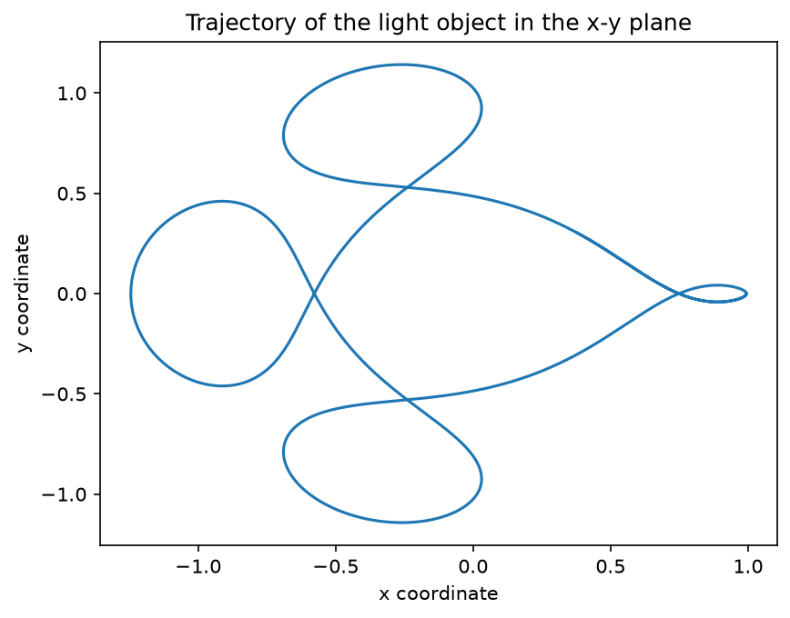
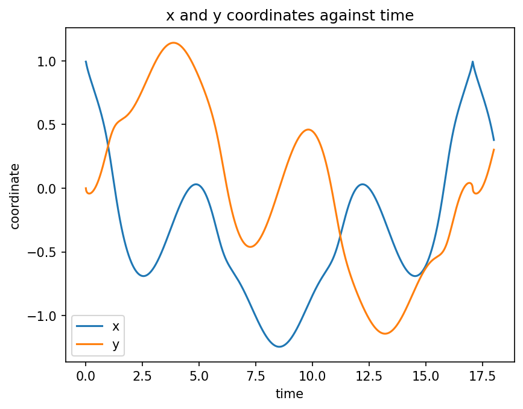
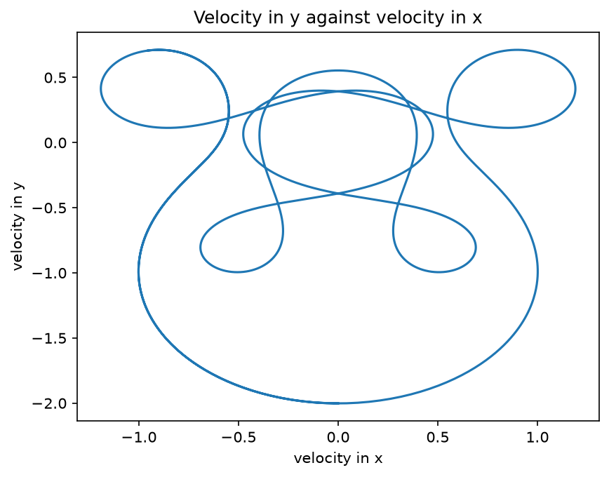
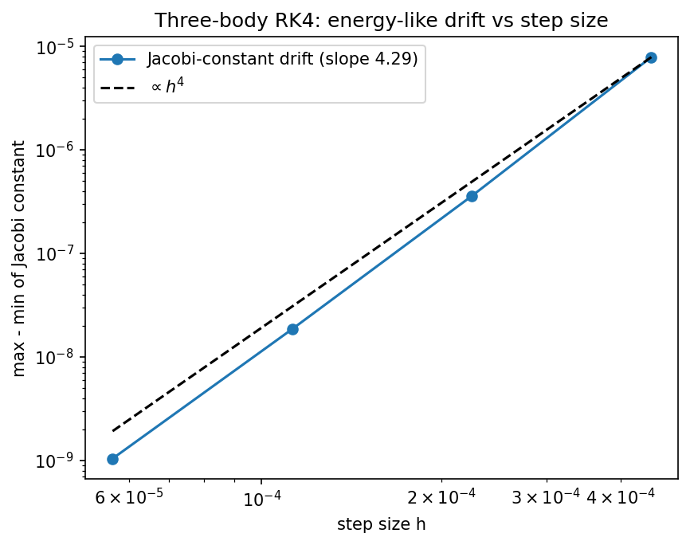

# Restricted Three-Body Problem

A light satellite moving in the field of two massive bodies (μ = 0.01228) in the rotating frame — the Arenstorf periodic orbit.

A plain-language summary is in [ABOUT.txt](ABOUT.txt).

## Physics
**Governing equations** (frame rotating with the two massive bodies, which sit at $-\mu$ and $1-\mu$; $r$ and $s$ are the satellite's distances to them):

$$\ddot x=x+2\dot y-(1-\mu)\frac{x+\mu}{r^{3}}-\mu\frac{x-1+\mu}{s^{3}},\qquad
\ddot y=y-2\dot x-(1-\mu)\frac{y}{r^{3}}-\mu\frac{y}{s^{3}}$$

**Why the orbit is periodic.** The restricted problem has special initial conditions whose trajectory returns exactly to its starting state. The starting values here are those of the Arenstorf orbit, with period $T\approx17.065$. Generic initial conditions are *not* periodic, and the motion is very sensitive to them, so nearby starting values drift off to a different path. The satellite also passes close to one of the massive bodies, so the integration needs small steps (100 000 here).

**Why this method.** There is no closed-form solution for three bodies, so we integrate numerically with fixed-step RK4. A built-in check is the Jacobi constant, an exactly conserved quantity of the rotating-frame problem; its drift measures the integrator's error.

**What the result means.** After one period the state is back at its start, and the Jacobi constant stays constant to about $10^{-5}$. The orbit stays bounded: each period the satellite makes a three-lobed loop around the heavy body and comes back to a close pass of the light one, instead of escaping.

## Run
From the repository root, `cd projects/restricted-three-body` first, then run it. For example:
```bash
python three_body.py
python three_body.py --steps 200000      # finer steps
python three_body.py --t-end 17.065      # one period
```
Run any script with `--help` to list its options. Figures are written to `output/`.

## Result
Orbit closes after one period (T ≈ 17.065); the Jacobi constant is conserved to < 1e-5.







## Accuracy
```bash
python three_body_convergence.py
```
The Jacobi-constant drift falls by 22×, 19× and 17.5× each time the step is halved, approaching the factor of 16 expected for a 4th-order method (fitted order 4.3). The coarse-step values are not yet in the asymptotic regime because of the close approach to the primary.



## Tested by
`test_three_body_orbit_closes_after_one_period, test_three_body_conserves_jacobi_constant, test_three_body_jacobi_drift_shrinks_like_h4` in [`tests/test_projects.py`](../../tests/test_projects.py).
