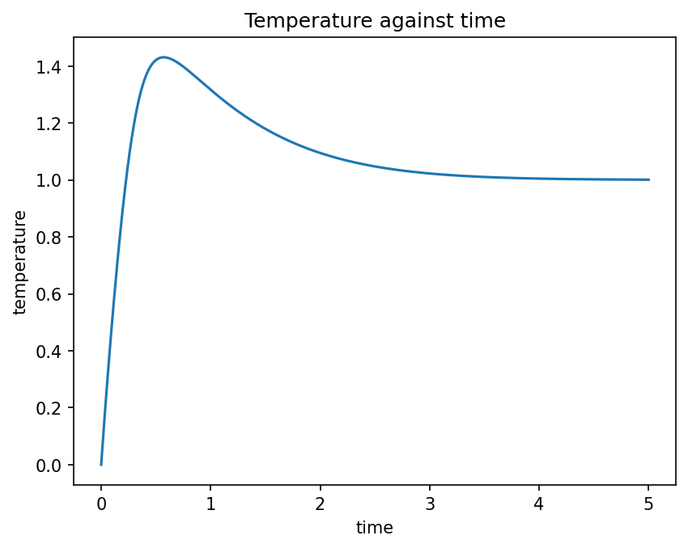
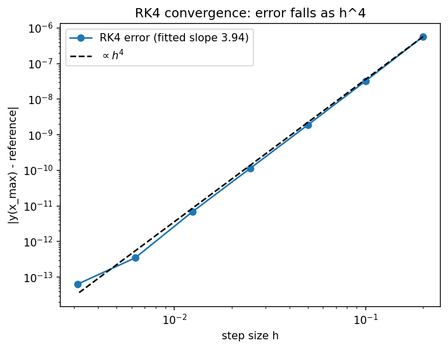

# RK4 Heating Model

Integrates dy/dx = a·e^(−2x) − b(y⁴ − 1): a body heated by a decaying source while radiating to its surroundings.

A plain-language summary is in [ABOUT.txt](ABOUT.txt).

## Physics
**Governing equation** (in scaled units, with the surroundings at $y=1$):

$$\frac{dy}{dx}=a\,e^{-2x}-b\,(y^4-1),\qquad y(0)=0$$

The first term is a heat source that decays exponentially; the second is radiative loss (a $T^4$ law) that vanishes at $y=1$.

**Why this method.** The equation is non-linear with no closed-form solution. Fourth-order Runge–Kutta is the standard workhorse: four function evaluations per step give a global error of order $h^4$ (verified below).

**What the result means.** The body heats while the source exceeds the radiative loss, peaks at $y\approx1.43$ near $t\approx0.57$ when the two balance, then relaxes back towards the surroundings temperature $y=1$ as the source dies away.

## Run
From the repository root, `cd projects/rk4-heating-model` first, then run it. For example:
```bash
python heating_model.py
python heating_model.py --a 8 --b 0.3 --xmax 10 --steps 50000
```
Run any script with `--help` to list its options. Figures are written to `output/`.

## Result
Peak **1.4307** at t = **0.571**.



## Accuracy
```bash
python heating_convergence.py
```
Against a high-accuracy `DOP853` reference, the error at $x_{\max}$ falls as $h^{3.94}$, matching the 4th-order theory.



## Tested by
`test_rk4_matches_scipy_solver, test_rk4_heating_is_fourth_order` in [`tests/test_projects.py`](../../tests/test_projects.py).
