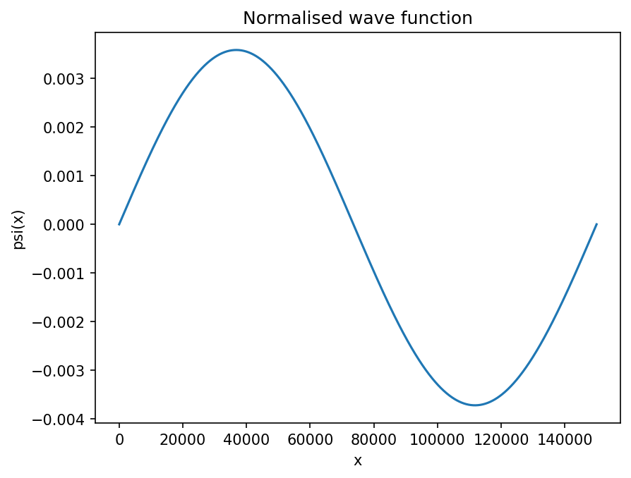
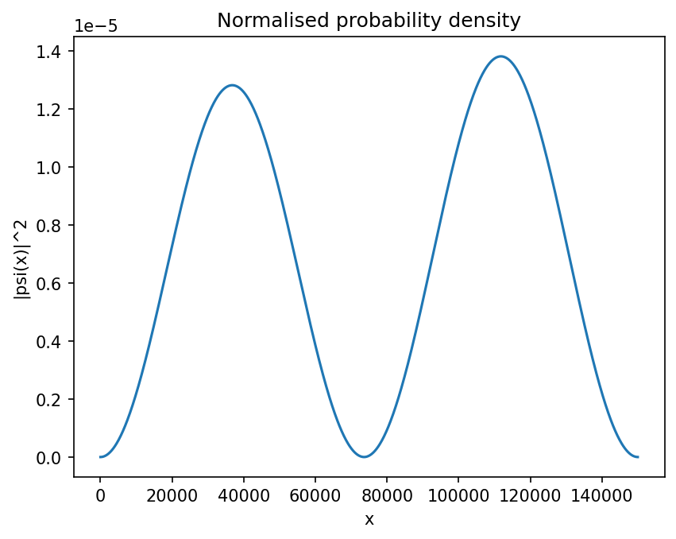
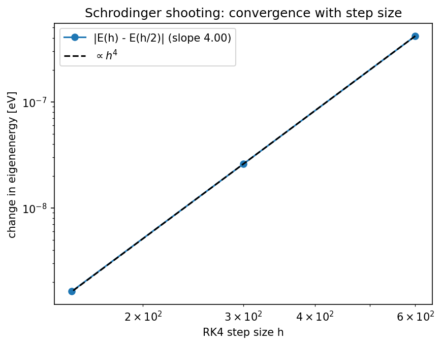

# Schrödinger Shooting Method

Eigenenergy and normalised wave function for a particle in a box with a step in its floor.

## Physics
**Governing equation.** The time-independent Schrödinger equation in a box of width $2a$ whose floor is $0$ for $x<a$ and $V_0$ for $x>a$, with $\psi(0)=\psi(2a)=0$:

$$-\frac{\hbar^2}{2m}\psi''+V(x)\,\psi=E\,\psi$$

**Why shooting plus bisection.** This is a boundary-value eigenvalue problem. For a trial energy $E$ we integrate the *initial-value* problem from $\psi(0)=0,\ \psi'(0)=1$ and look at $\psi(2a;E)$, which is a continuous function of $E$ that changes sign at each eigenvalue. Bisection only needs that sign change, so it cannot diverge and needs no derivatives. The wave function is then normalised with Simpson's rule so that $\int|\psi|^2dx=1$.

**What the result means.** The eigenvalue bracketed by [50, 100] eV is $E=69.198$ eV; its wave function has two interior nodes and oscillates faster on the lower-potential side, where the kinetic energy is larger.

## Run
```bash
python schrodinger.py
python schrodinger.py --v0 8 --e-low 60 --e-high 120 --steps 2000
```
Run any script with `--help` to list its options. Figures are written to `output/`.

## Result
E = **69.1985 eV**.





## Accuracy
```bash
python schrodinger_convergence.py
```
The potential is piecewise constant, so each RK4 step is given a single value of $V$ (taken at the step midpoint) and no step straddles the jump at $x=a$. The eigenenergy then changes by a factor 16 each time the step is halved (fitted order 4.00), and is converged to better than $10^{-8}$ eV by 1000 steps.



## Tested by
`test_schrodinger_energy_and_normalisation, test_schrodinger_energy_converges_with_fourth_order` in [`tests/test_projects.py`](../../tests/test_projects.py).
