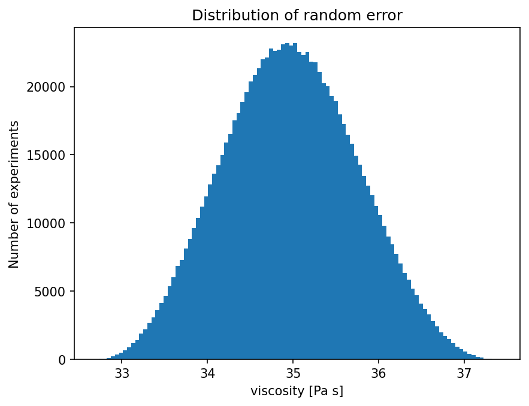
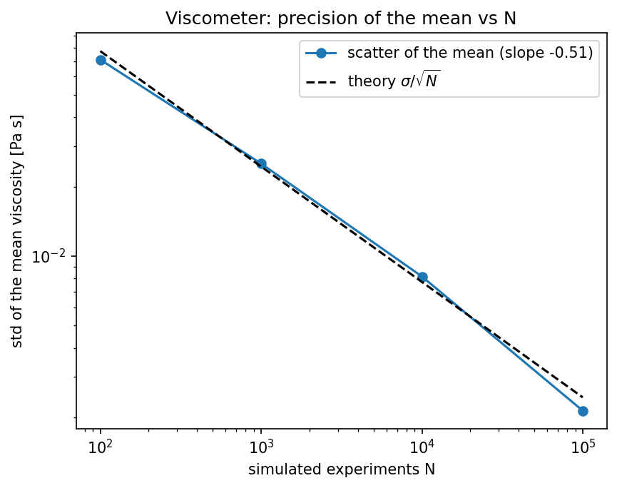

# Viscometer Uncertainty

Monte-Carlo error propagation for the falling-sphere method of measuring a liquid's viscosity.

## Physics
**Governing law.** In slow flow a sphere reaches the Stokes terminal velocity $v=\dfrac{2(\rho_s-\rho_l)g\,r^2}{9\eta}$. With $v=l/t$ for a fall distance $l$ in time $t$:

$$\eta=\frac{2(\rho_s-\rho_l)\,g\,r^2\,t}{9\,l}$$

**Why this method.** $\eta$ depends non-linearly on six measured quantities (the densities themselves are ratios of measured masses and volumes), so propagating errors analytically means a lot of partial derivatives. Instead, each measurement is drawn uniformly within its stated uncertainty and the spread of the resulting $\eta$ values gives the uncertainty directly, with the full distribution shape for free.

**What the result means.** $\eta\approx35.0\pm0.8$ Pa·s, a precision of about 2 %. The sphere diameter (about 2.5 %), the sphere mass (2.4 %) and the fall time (1.6 %) dominate the error; the fall distance adds 0.5 %. The model assumes slow, unbounded flow (no Reynolds-number or wall corrections) and rectangular rather than Gaussian uncertainties.

**Units note.** The liquid volume (0.1) is used in m³, as in the original script, which makes the liquid density only 1.4 kg/m³ and its effect negligible. If that volume is really 0.1 litres, run with `--liquid-volume-in-litres`: the liquid density becomes 1400 kg/m³ and $\eta\approx25.2\pm1.0$ Pa·s.

## Run
```bash
python viscometer.py --n 50000 --seed 1
python viscometer.py --liquid-volume-in-litres
```
Run any script with `--help` to list its options. Figures are written to `output/`.

## Result
**η ≈ 35.0 ± 0.8 Pa·s** (~2 % precision; see the units note above).



## Accuracy
```bash
python viscometer_convergence.py
```
The spread of a single experiment (0.77 Pa·s) is fixed by the input uncertainties, but the *mean* of N experiments becomes better defined as $\sigma/\sqrt N$ (fitted slope −0.51, theory −0.5).



## Tested by
`test_viscosity_mean_close_to_nominal_value, test_viscometer_mean_precision_improves_like_inverse_sqrt_n` in [`tests/test_projects.py`](../../tests/test_projects.py).
